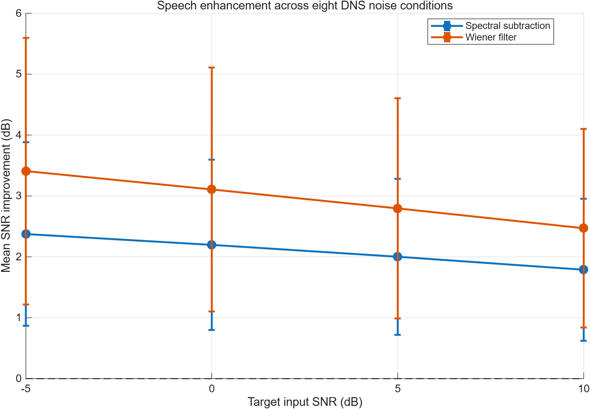
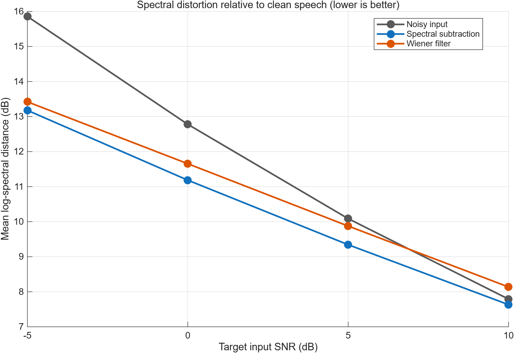
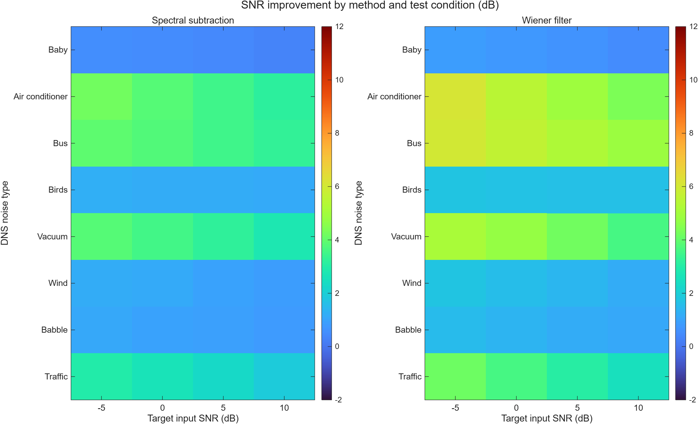
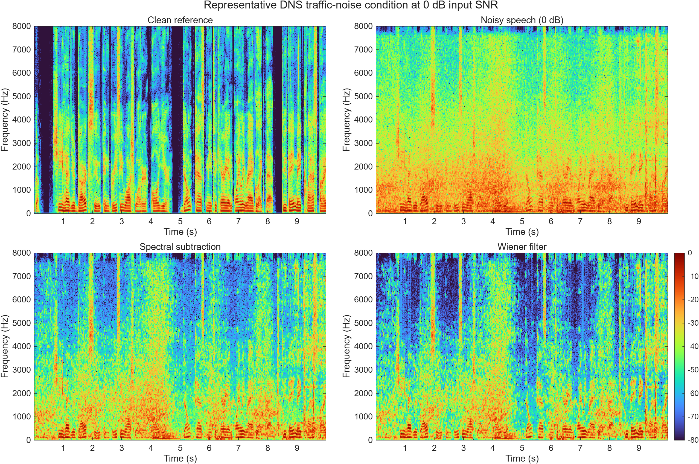

# Wiener Filtering vs Spectral Subtraction for Speech Noise Reduction

**ELEC5305 Acoustics, Speech and Signal Processing — Final Project**  
**Student:** Zhizhong Chen (530668932)  
**Project site:** <https://czz0806.github.io/elec5305-project-530668932/>  
**Repository:** <https://github.com/czz0806/elec5305-project-530668932>

## Research question

How do classical Wiener filtering and spectral subtraction differ in noise
reduction and speech distortion across several real-world noise types and input
signal-to-noise ratios (SNRs), when both methods use the same short-time Fourier
transform (STFT) configuration and noise-power estimate?

## Main finding

The controlled benchmark contains **eight DNS noise conditions at four input
SNRs**, giving **32 paired test cases**. Wiener filtering produced the larger
SNR improvement in all 32 cases. Its overall mean improvement was **2.945 dB**,
compared with **2.090 dB** for spectral subtraction. However, spectral
subtraction produced the slightly lower mean log-spectral distance (LSD):
**10.334 dB** versus **10.772 dB** for Wiener filtering. Thus, the method with
the strongest energy-based noise reduction did not also give the smallest
spectral distortion.





## Experimental design

- **Dataset:** eight aligned clean/noisy pairs from the Microsoft DNS Challenge
  synthetic no-reverberation test set.
- **Noise types:** traffic, babble, wind, vacuum, birds, bus, air conditioner and
  baby sounds.
- **Controlled input SNRs:** -5, 0, 5 and 10 dB.
- **Common analysis:** 16 kHz mono audio, 32 ms periodic Hamming window and 50%
  overlap.
- **Spectral subtraction:** subtraction factor 1.0 and magnitude floor 0.02.
- **Wiener filtering:** power-ratio gain with gain floor 0.05.
- **Metrics:** global SNR improvement, segmental SNR and log-spectral distance.
- **Fair comparison:** both algorithms use the same STFT, overlap-add synthesis
  and oracle noise-power spectral-density estimate.

The oracle estimate is intentionally used as an experimental control. It
isolates the effect of the two spectral gain rules, but it is not available in
a practical real-time system. This limitation is discussed in the report.

## Results

| Input SNR (dB) | Spectral subtraction SNR improvement (dB) | Wiener SNR improvement (dB) | Spectral subtraction LSD (dB) | Wiener LSD (dB) |
|---:|---:|---:|---:|---:|
| -5 | 2.374 | 3.408 | 13.178 | 13.422 |
| 0  | 2.197 | 3.107 | 11.185 | 11.654 |
| 5  | 2.002 | 2.796 | 9.342 | 9.875 |
| 10 | 1.789 | 2.470 | 7.631 | 8.136 |
| **Overall mean** | **2.090** | **2.945** | **10.334** | **10.772** |

The SNR benefit decreased as the input became cleaner, which is expected
because there was less removable noise. Performance also varied substantially
by noise type. Stationary or slowly varying air-conditioner, bus and vacuum
noise benefited most, while nonstationary baby, birds and babble conditions
were more difficult.





Detailed results are available in:

- [All 96 signal/method measurements](results/final/final_metrics.csv)
- [Summary by method and input SNR](results/final/final_summary.csv)
- [Plain-text result summary](results/final/final_summary.txt)
- [Representative listening examples](results/final/audio_demo/)

## How to reproduce the experiment in MATLAB

### Requirements

- MATLAB R2024b (or a recent compatible release)
- Signal Processing Toolbox

### Run

1. Download or clone this repository.
2. Keep the `audio`, `code` and `results` folders together.
3. In MATLAB, set the repository root as the current folder.
4. Open [`code/run_final_project.m`](code/run_final_project.m).
5. Click **Run**, or enter the following in the Command Window:

   ```matlab
   run('code/run_final_project.m')
   ```

6. The script checks all required files, evaluates all 32 conditions and writes
   tables, figures and demonstration WAV files to `results/final/`.

An independent Python implementation is included only as a transparent
cross-check of the reported numerical results:
[`code/run_final_project_reference.py`](code/run_final_project_reference.py).
It is not required to run the submitted MATLAB implementation.

## Project files

- [Final MATLAB experiment](code/run_final_project.m)
- [Independent numerical cross-check](code/run_final_project_reference.py)
- [Preliminary MATLAB prototype](code/run_feedback2.m)
- [Audio provenance and experimental construction](audio/SOURCE.txt)
- [Final report](ELEC5305_Final_Project_Zhizhong_Chen_530668932.pdf)
- [Original project proposal](ELEC5305_Project_Proposal_Zhizhong_Chen.pdf)

## Video demonstration

**Final video link:** to be added after the demonstration is recorded and
uploaded. The link must also be added to the final report before Canvas
submission.

## Key limitations

1. Only eight ten-second utterances are used, so the result should not be
   generalized to all speakers, languages or acoustic environments.
2. The oracle noise estimate is a controlled upper-bound comparison, not a
   causal deployable noise estimator.
3. SNR and LSD do not fully represent intelligibility or human perceptual
   quality. A larger listening study, STOI/PESQ-style measures and a practical
   noise tracker would strengthen future work.
4. Only one fixed parameter set is reported for each algorithm. Parameter
   sweeps could map the complete suppression-versus-distortion trade-off.

## References

1. S. F. Boll, “Suppression of acoustic noise in speech using spectral
   subtraction,” *IEEE Transactions on Acoustics, Speech, and Signal
   Processing*, vol. 27, no. 2, pp. 113–120, 1979.
   <https://doi.org/10.1109/TASSP.1979.1163209>
2. J. S. Lim and A. V. Oppenheim, “Enhancement and bandwidth compression of
   noisy speech,” *Proceedings of the IEEE*, vol. 67, no. 12, pp. 1586–1604,
   1979. <https://doi.org/10.1109/PROC.1979.11540>
3. P. Scalart and J. V. Filho, “Speech enhancement based on a priori
   signal-to-noise estimation,” in *Proc. ICASSP*, 1996, pp. 629–632.
   <https://doi.org/10.1109/ICASSP.1996.543199>
4. Y. Hu and P. C. Loizou, “Evaluation of objective quality measures for
   speech enhancement,” *IEEE Transactions on Audio, Speech, and Language
   Processing*, vol. 16, no. 1, pp. 229–238, 2008.
   <https://doi.org/10.1109/TASL.2007.911054>
5. C. K. A. Reddy et al., “INTERSPEECH 2021 Deep Noise Suppression Challenge,”
   in *Proc. Interspeech*, 2021, pp. 2796–2800.
   <https://doi.org/10.21437/Interspeech.2021-1609>

## Earlier project stage

The initial Feedback Two prototype used one 0 dB traffic-noise pair and reported
2.622 dB SNR improvement for spectral subtraction and 3.597 dB for Wiener
filtering. The final project preserves that case inside a wider controlled
benchmark rather than discarding the earlier work.
